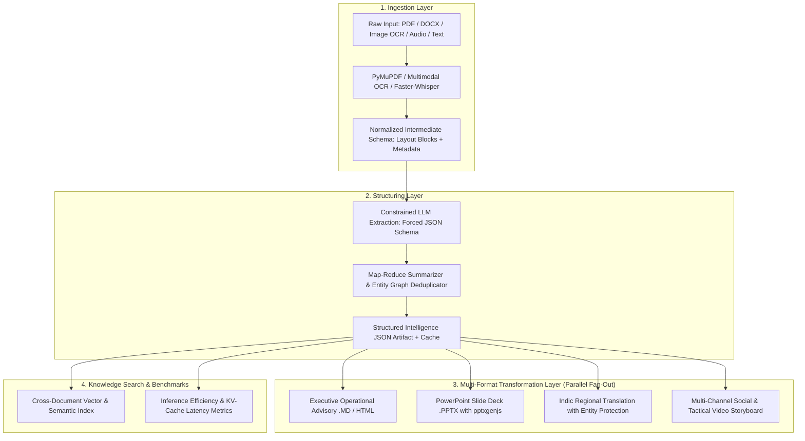

# TransformAI — GenAI Content Transformation Platform
**Smart India Hackathon 2026 • Problem Statement: SIH26154**
**Sponsoring Organization:** National Technical Research Organisation (NTRO) • **Theme:** Smart Automation / Cybersecurity

---

## 📌 Executive Summary
**TransformAI** is an automated multi-format intelligence content transformation platform. It ingests raw, heterogenous source documents (scanned PDFs, multi-section DOCX, OCR images, tactical radio audio transcripts) and transforms them in parallel into standardized, multi-audience deliverables:

1. **Structured Operational Brief & Security Advisory** (Markdown/HTML with timeline & entity matrix)
2. **Auto-Generated Presentation Slide Deck** (Interactive visual preview + downloadable `.pptx` PowerPoint presentation)
3. **Indic Regional Translation** (Hindi, Marathi, Bengali, Tamil, Telugu, etc. with entity/technical token preservation)
4. **Multi-Channel Communications Pack** (Executive LinkedIn post, Twitter/X thread, 60-second video storyboard)
5. **Cross-Document Knowledge Search** (Semantic grounded retrieval & synthesis with doc ID and section citations)
6. **Inference Efficiency Benchmark Inspector** (Live latency breakdown, prefix KV-cache reuse indicators, signal confidence metrics)

---

## 🏗️ System Architecture



---

## 🚀 Key Technical Highlights & Differentiators

- **Forced Schema Constraints**: Guaranteed structured JSON extraction without fragile regex or malformed parsing.
- **Prefix KV-Cache Optimization**: The structured document context is cached; subsequent transformation requests (e.g. Slide generation, Indic translation) reuse precomputed token activations, drastically lowering latency.
- **Downloadable PowerPoint (.pptx)**: Generates corporate/government-themed `.pptx` decks directly with slide layouts, table grids, and speaker notes.
- **Side-by-Side Indic Translation**: Translates narrative analysis into Indian regional languages (Hindi, Marathi, Tamil, etc.) while preserving CVE identifiers, IP addresses, and acronyms in original Latin script.
- **Configurable Prompt Engine**: Operators can adjust or add transformation formats on the fly via the template manager.

---

## ⚡ Quickstart & Deployment

### Development Mode
```bash
# Install dependencies
npm install

# Start full-stack development server (Express + Vite on port 3000)
npm run dev
```

### Production Build & Launch
```bash
npm run build
npm start
```

---

## 🎬 4-Step Cold Demo Script

1. **Step 1: Ingest Critical Infrastructure Advisory (PDF OCR)**
   - Click **"Load Sample"** in the top navigation and select *NTRO-ADVISORY-2026-088: Critical Infrastructure Cyber Incident*.
   - Click **"Execute Content Transformation"**.
   - Watch the 3-stage pipeline execute with real-time latency indicators.

2. **Step 2: Review Multi-Format Deliverables**
   - Click **Executive Brief**: Notice the threat classification badge, chronological timeline, and mitigation directives.
   - Click **Slide Deck (.pptx)**: Click *Next Slide* to browse the interactive preview, then click **Download PowerPoint (.pptx)** to get the actual `.pptx` file.
   - Click **Indic: Hindi**: Notice the side-by-side comparative split view with proper nouns (NTRO, CERT-In, SCADA) preserved.
   - Click **Social & Storyboard**: Inspect the LinkedIn post, Twitter thread, and 60-second video storyboard.

3. **Step 3: Inspect Inference Efficiency Metrics (Phase 5)**
   - Scroll down to the **Inference Efficiency Benchmark** panel to see the latency breakdown and **Prefix Cache HIT** status.

4. **Step 4: Cross-Document Semantic Search (Phase 7)**
   - Switch to the **Knowledge Search** tab.
   - Click any sample question (e.g. *"What zero-day vulnerability and threat actor targeted the Western Power Grid?"*).
   - View the grounded synthesized answer along with exact document ID and section citations.
